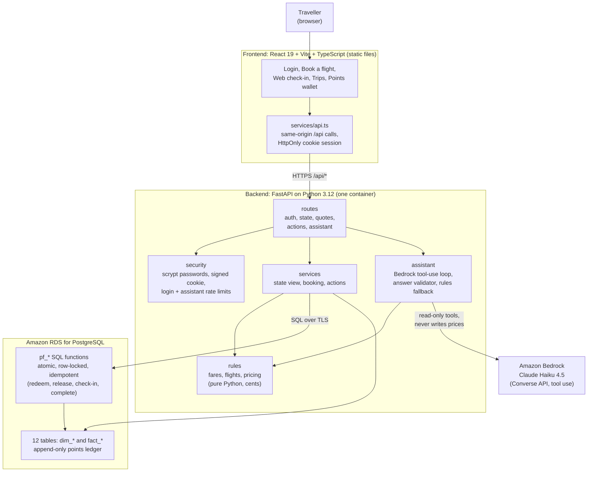

# PerkFlex: project brief, architecture and AWS services

Status: hackathon prototype. Built and tested locally against an AWS RDS database. Not yet deployed to AWS. There is no infrastructure-as-code in the repo yet.

---

## 1. Project brief

### What it is

PerkFlex is a Southwest-inspired airline-benefits prototype. Its idea: a traveller who holds a benefit they will not use (an included checked bag, or a premium seat) can release it back to the airline in exchange for points. Another traveller who needs that benefit can get it for points instead of cash. The airline stays the intermediary, so no benefit is transferred between people, and fare rules such as refundability stay with the fare.

The prototype covers the whole journey:

- **Book a flight.** Pick any route between five airports, set preferences (bags, seat, refundability, budget), and compare four fares: Basic, Choice, Choice Preferred, Choice Extra.
- **Fare assistant.** A "Find my best fare" assistant reads the traveller's needs, including free text such as "two bags, near the front, refundable, under $400". It recommends a fare and explains why. The AI explains. The server prices.
- **Web check-in.** The traveller sees what their fare, tier (Silver, Gold, Platinum) and card already give them, and gets offers to release a bag or seat for pending points, or to buy a bag or upgrade a seat with points.
- **Points wallet and trips.** Balances, pending points, a ledger, a boarding pass, and a simulated flight completion that posts the pending points exactly once.

### Who uses it

| Role          | What they do                                             |
| ------------- | -------------------------------------------------------- |
| Traveller     | Signs in, books, checks in, releases or redeems benefits |
| Airline admin | An account exists, but there is no admin screen yet      |

There are 20 synthetic travellers (different tiers, cards and balances; one has no trip and lands on "Book a flight") plus one airline admin account.

### Business rules in brief

- Bag allowances from fare, tier and card use the **maximum**, never the sum.
- At most one rewarded release per traveller per flight.
- A redeemed benefit cannot be released again.
- Release rewards are funded from a per-flight campaign budget.
- Pending points cannot be spent. They post once, after check-in and flight completion.
- Insufficient points, an unavailable seat or an exhausted budget leave everything unchanged.
- Benefit changes close when check-in is completed.

| Benefit            | Receiver pays | Giver earns (pending) |
| ------------------ | ------------: | --------------------: |
| First bag          |     3,000 pts |               800 pts |
| Additional bag     |     3,500 pts |               800 pts |
| Preferred seat     |     2,200 pts |               700 pts |
| Extra Legroom seat |     4,500 pts |             1,500 pts |

### What is real and what is synthetic

All fares, points values, flights, inventory and travellers are fictional. This is not affiliated with Southwest and uses no real airline systems, payments or loyalty accounts. The release-and-redeem exchange is a proposed concept and would need airline approval. Flights are the same three departures (WN 2418, 968, 1820) on every route on 16 Dec 2027, plus one extra Dallas to Denver flight on 22 Oct 2026 for the presentation traveller.

### Current status

| Area           | State                                                                                      |
| -------------- | ------------------------------------------------------------------------------------------ |
| Frontend       | React app, all data from the API                                                           |
| Backend        | FastAPI (Python 3.12), all rules and state server-side                                     |
| Database       | Amazon RDS PostgreSQL (`perkflexdb`), 21 migrations applied                                |
| AI assistant   | Amazon Bedrock, Claude Haiku 4.5, with server-side validation                              |
| Tests          | 311 Python tests pass (including database tests and API tests), 16 UI tests pass, build OK |
| Container      | `backend/Dockerfile` written but **never built** (no Docker on the dev machine)            |
| AWS deployment | Not done. No IaC                                                                           |

---

## 2. Architecture

### Application architecture



### Components

**Frontend** (`frontend/`): React 19, TypeScript, Vite, plain CSS, Lucide icons. It holds no business rules and no browser storage. Everything shown comes from the API. Display constants (fare names, flight times, airports) are generated from the Python rules, so there is one source of truth.

**Backend** (`backend/app/`): FastAPI on Python 3.12, about 2,500 lines.

| Module                             | Job                                                                                     |
| ---------------------------------- | --------------------------------------------------------------------------------------- |
| `routes/`                          | HTTP endpoints (auth, state, quotes, actions, assistant)                                |
| `security/`                        | scrypt password hashes, signed HttpOnly session cookie, login and assistant rate limits |
| `services/`                        | Builds the traveller's state, books flights, applies actions                            |
| `rules/`                           | Fares, flights, entitlements and pricing. Pure Python, money in cents                   |
| `assistant/`                       | Bedrock tool-use loop, answer validator, deterministic fallback                         |
| `db.py`, `migrations.py`, `cli.py` | Connection pool, SQL migration runner, `check / inspect / migrate / seed-users`         |

**Database** (Amazon RDS for PostgreSQL): 12 tables (6 dimension, 6 fact), including an append-only points ledger enforced by a trigger. Every state change (open check-in, set bags, release bag or seat, redeem bag or seat, complete check-in, complete flight) runs inside a Postgres `pf_*` function. These are row-locked, atomic and idempotent, so a retried request cannot double-spend or double-pay.

### API

| Endpoint                                                            | Purpose                                                                                |
| ------------------------------------------------------------------- | -------------------------------------------------------------------------------------- |
| `GET /api/health`                                                   | Liveness and database check                                                            |
| `POST /api/auth/login`, `POST /api/auth/logout`, `GET /api/auth/me` | Session                                                                                |
| `GET /api/state`                                                    | The signed-in traveller's full state                                                   |
| `POST /api/quotes`                                                  | All four fares priced for a route, flight and needs                                    |
| `POST /api/actions`                                                 | One action: `open-checkin`, `bags`, `release`, `redeem`, `checkin`, `complete`, `book` |
| `POST /api/assistant/best-fare`                                     | AI fare recommendation                                                                 |
| `POST /api/demo/switch`                                             | Switch demo traveller (demo mode only)                                                 |

Business-rule refusals (not enough points, seat taken) return HTTP 200 with the unchanged state and `error: true`. Authentication and validation problems use real 4xx codes.

### How a request flows (redeem a bag)

1. The browser sends `POST /api/actions` with the session cookie and an idempotency key.
2. FastAPI verifies the signed cookie and loads the traveller.
3. The action calls `pf_redeem_bag` in Postgres. The function locks the booking, checks the check-in window, charges points, writes ledger rows and updates the wallet, all in one transaction.
4. FastAPI rebuilds and returns the full state. The UI re-renders from it.

### AI design

- The model reads the request and has two tools: a read-only fare quote tool and a submit tool.
- **The model never produces prices.** The server re-prices every fare. It rejects any answer whose fare does not meet the stated needs, or that mentions a dollar or points amount the pricing engine did not produce. A rejected answer gets one retry. After that, or when Bedrock is slow or down, the user gets the rules-only answer (`source: "fallback"`).
- The route reads the traveller's data in a short database transaction and releases the connection before calling the model, so slow model calls do not hold database connections.
- Typical live latency is about 4.6 seconds per call, with a 25-second overall limit.

### Security design

- Session: signed, HttpOnly, SameSite=Lax cookie. It is marked `Secure` when `ENVIRONMENT=production`. The cookie is the only session; the browser stores nothing.
- Passwords: scrypt hashes. Login attempts are limited (10 failures per 15 minutes). The assistant is limited to 12 calls per minute per traveller.
- Request bodies are capped at 8 KB. Responses are `no-store`. Validation errors return field names only.
- Database access uses TLS with certificate verification against the RDS CA bundle.
- Every action is scoped to the signed-in traveller on the server. A traveller cannot act for someone else.

### Testing

- 311 Python tests: pricing parity against fixtures captured from the original TypeScript engine, security, state, actions, API, and assistant (with a fake model, plus live Bedrock tests that run only on request).
- Database tests build a throwaway schema on RDS and drop it afterwards, so real data is never touched.
- 16 UI tests run the real React app against a scripted fake API.

---

## 3. AWS services needed

Region used so far: us-east-1.

### AWS deployment architecture

```mermaid
flowchart LR
    user["Traveller<br/>(browser)"]
    r53["Route 53<br/>DNS (optional, for a custom domain)"]
    waf["AWS WAF"]
    cf["Amazon CloudFront<br/>+ ACM certificate"]
    s3[("Amazon S3<br/>frontend/dist<br/>(private, via OAC)")]

    user --> r53 --> cf
    waf -.-> cf
    cf -->|"static files"| s3

    subgraph vpc["Amazon VPC (2 Availability Zones)"]
        subgraph pub["Public subnets"]
            alb["Application Load Balancer<br/>HTTPS, health check /api/health"]
        end
        subgraph priv["Private subnets"]
            ecs["Amazon ECS on AWS Fargate<br/>PerkFlex API container, port 8080<br/>(ECS Express Mode)"]
            rds[("Amazon RDS for PostgreSQL<br/>Multi-AZ, encrypted, TLS")]
            vpce["VPC endpoints<br/>Bedrock Runtime, Secrets Manager,<br/>ECR, CloudWatch Logs, S3"]
        end
        alb --> ecs
        ecs -->|"5432, SG to SG"| rds
        ecs --> vpce
    end

    cf -->|"/api/*"| alb

    ecr["Amazon ECR<br/>container image"]
    sm["AWS Secrets Manager<br/>DB password, SESSION_SECRET"]
    bedrock["Amazon Bedrock<br/>Claude Haiku 4.5"]
    cw["Amazon CloudWatch<br/>logs, metrics, alarms"]
    iam["IAM roles<br/>task role: bedrock:InvokeModel"]

    ecr -.->|"image pull"| ecs
    sm -.->|"injected at start"| ecs
    vpce --> bedrock
    ecs -.->|"JSON logs"| cw
    iam -.-> ecs

    cicd["CI/CD<br/>GitHub Actions or CodePipeline"]
    cicd -.->|"build + push"| ecr
    cicd -.->|"deploy + one-off migrate task"| ecs
    cicd -.->|"upload dist, invalidate"| s3
```



### Required for a working deployment

| Service                                   | Used for                                                              | Notes                                                                                                                                                                                           |
| ----------------------------------------- | --------------------------------------------------------------------- | ----------------------------------------------------------------------------------------------------------------------------------------------------------------------------------------------- |
| **Amazon ECS on AWS Fargate**             | Runs the API container                                                | Use **ECS Express Mode** (provisions the load balancer, HTTPS and scaling). AWS App Runner stopped accepting new customers on 30 April 2026, so it is not an option for a new account           |
| **Application Load Balancer**             | HTTPS entry for the API, health check `/api/health`                   | Created by Express Mode, or by you for standard ECS                                                                                                                                             |
| **Amazon ECR**                            | Stores the API container image                                        | Build from `backend/Dockerfile`                                                                                                                                                                 |
| **Amazon RDS for PostgreSQL**             | System of record                                                      | Already exists. For production: private subnets, Multi-AZ, encryption, automated backups                                                                                                        |
| **Amazon VPC** (subnets, security groups) | Network isolation                                                     | ALB in public subnets. Tasks and RDS in private subnets. Port 5432 only from the API's security group                                                                                           |
| **Amazon S3**                             | Hosts the built frontend (`frontend/dist`)                            | Private bucket                                                                                                                                                                                  |
| **Amazon CloudFront**                     | Serves the frontend and routes `/api/*` to the ALB on the same domain | Same domain keeps the session cookie first-party. Use Origin Access Control for S3                                                                                                              |
| **Amazon Bedrock**                        | AI fare assistant                                                     | Claude Haiku 4.5 through the `us.anthropic.claude-haiku-4-5-20251001-v1:0` inference profile. Enable model access in the account                                                                |
| **AWS IAM**                               | Roles and permissions                                                 | Task execution role, task role (`bedrock:InvokeModel` on the one inference profile), Express Mode infrastructure role. Replaces the Bedrock API key                                             |
| **AWS Secrets Manager**                   | `DB_PASSWORD`, `SESSION_SECRET`                                       | Injected into the task as environment variables. Non-secret settings can live in task definition variables                                                                                      |
| **Amazon CloudWatch**                     | Logs, metrics, alarms                                                 | The API writes JSON log lines. Alarm on 5xx rate, p95 latency, RDS CPU and connections, Bedrock errors                                                                                          |
| **AWS Certificate Manager (ACM)**         | TLS certificates                                                      | Needed for a custom domain on CloudFront (create it in us-east-1) and for an HTTPS listener on your own ALB. Not needed if you use only the default CloudFront address and the Express Mode URL |

### Strongly recommended

| Service                                                                        | Why                                                                                                                           |
| ------------------------------------------------------------------------------ | ----------------------------------------------------------------------------------------------------------------------------- |
| **VPC endpoints** (Bedrock Runtime, Secrets Manager, ECR, CloudWatch Logs, S3) | Lets private tasks reach AWS services without a NAT gateway, which also cuts cost                                             |
| **AWS WAF** on CloudFront                                                      | Managed rules and IP rate limiting. The app's login limiter is in memory per container, so it is not a shared defence         |
| **CI/CD**: GitHub Actions (with OIDC to AWS) or AWS CodePipeline and CodeBuild | Build and push the image, deploy the service, upload `dist` to S3 and invalidate CloudFront, run migrations as a one-off task |
| **AWS KMS**                                                                    | Customer-managed key for RDS and secrets if your policy requires it. AWS-managed keys work by default                         |
| **AWS CloudTrail**                                                             | Audit log of AWS API activity                                                                                                 |

### Optional, depending on scale and goals

| Service                                        | When                                                                                                                                                                                                           |
| ---------------------------------------------- | -------------------------------------------------------------------------------------------------------------------------------------------------------------------------------------------------------------- |
| **Amazon ElastiCache (Valkey or Redis)**       | When you run more than one API task, to share the login and assistant rate limits                                                                                                                              |
| **Amazon Cognito**                             | Production identity. The demo uses accounts in the `dim_user_account` table with shared demo passwords, which should not exist in production                                                                   |
| **RDS Proxy**                                  | Only if the number of tasks grows enough to strain database connections (each task opens a small pool of up to 5)                                                                                              |
| **AWS Backup**                                 | Central backup policy beyond RDS automated backups                                                                                                                                                             |
| **Amazon Bedrock Guardrails**                  | An extra content filter layer on top of the server-side validation                                                                                                                                             |
| **AWS X-Ray or ADOT (OpenTelemetry)**          | Distributed tracing                                                                                                                                                                                            |
| **Amazon GuardDuty, AWS Config, Security Hub** | Account-level security monitoring                                                                                                                                                                              |
| **Amazon Route 53** (or any DNS provider)      | A friendly name such as perkflex.example.com for CloudFront. Also gives the ALB origin a name that can carry a certificate. Optional for a demo: CloudFront provides a working https address on its own domain |
| **AWS CDK or Terraform**                       | Infrastructure as code. None exists in the repo today                                                                                                                                                          |

### Possible later: agent platform

If you add the LangGraph assistant flows discussed earlier: **Amazon Bedrock AgentCore** (Runtime to host the agent, Gateway for tools, Identity, Memory, Observability), plus an ECR repository for the agent image and an IAM permission for the API to invoke the runtime. The API stays the system of record. The agent only reads and proposes.

---

## 4. Configuration for the container

The container reads everything from environment variables. No `.env` file is baked into the image.

| Variable                                   | Production value                                                                                           |
| ------------------------------------------ | ---------------------------------------------------------------------------------------------------------- |
| `ENVIRONMENT`                              | `production` (marks the session cookie `Secure`)                                                           |
| `DEMO_MODE`                                | `false`                                                                                                    |
| `DEMO_NOW`                                 | empty (use the real clock). Note the seed flights are in 2026 and 2027, so check-in windows depend on this |
| `DB_HOST`, `DB_PORT`, `DB_NAME`, `DB_USER` | RDS endpoint and credentials                                                                               |
| `DB_PASSWORD`                              | from Secrets Manager                                                                                       |
| `DB_SSL`                                   | `verify`                                                                                                   |
| `SESSION_SECRET`                           | from Secrets Manager, at least 32 characters                                                               |
| `AWS_REGION`                               | `us-east-1`                                                                                                |
| `BEDROCK_MODEL_ID`                         | `us.anthropic.claude-haiku-4-5-20251001-v1:0`                                                              |
| `AWS_BEARER_TOKEN_BEDROCK`                 | **not set**. Use the task IAM role                                                                         |

Container: port 8080, runs as a non-root user, health check on `/api/health`.

---

## 5. Deployment steps (outline)

1. Create the VPC, subnets and security groups (or reuse the existing ones that hold RDS).
2. Build the image from `backend/Dockerfile`, push it to ECR.
3. Create the secrets in Secrets Manager and the IAM roles.
4. Create the ECS Express Mode service from the image, with the environment above.
5. Run migrations once from a one-off task: `python -m app.cli migrate`. Do not run them on every container start.
6. Run `python -m app.cli seed-users` only for a demo environment.
7. Build the frontend (`npm run build`) and upload `frontend/dist` to S3.
8. Create the CloudFront distribution: S3 as the default origin, the ALB as the origin for `/api/*`. Add the domain, certificate and WAF.
9. Set up CloudWatch alarms and test sign-in, a booking, a redeem and the assistant end to end.

---

## 6. Risks and open items before deploying

1. **The Dockerfile has never been built.** Build and test it in CI or on a machine with Docker first.
2. **Rotate credentials.** The RDS password and a Bedrock API key were shared in chat. The Bedrock long-term key also expires on 26 Oct 2026.
3. **Demo accounts and demo mode.** Turn off `DEMO_MODE` and replace the shared demo logins (Cognito or another identity provider) for anything beyond a demo.
4. **Rate limits are per container.** With more than one task, add a shared store or rely on WAF.
5. **Bedrock access.** Confirm model access for Claude Haiku 4.5 in the target account and region.
6. **Check-in dates.** Seed flights are dated 2026 and 2027. Without `DEMO_NOW` set, real-time check-in windows will not match the data.
7. **IaC is a single CloudFormation template** (`infra/perkflex-stack.yaml`, linted but not yet deployed). There is no CI yet; pick GitHub Actions or CodePipeline.
8. **Simulated flight completion.** "Complete trip" is a demo control. In a real system an airline-side process would post points.
9. **Scope limits.** One adult and one active trip per traveller, synthetic domestic flights, no payments, cancellations or waitlists.

---

## 7. Repository map

```text
perkflex/
├── backend/
│   ├── app/             FastAPI service (routes, security, services, rules, assistant)
│   ├── db/sql/          Numbered SQL migrations (schema, seed, functions, travellers, routes)
│   ├── db/certs/        RDS CA bundle
│   ├── tests/           Python tests and pricing parity fixtures
│   ├── scripts/         Frontend data generator, throwaway-schema helper
│   └── Dockerfile
├── frontend/            React app and UI tests
├── docs/                This document
├── infra/               CloudFormation template (perkflex-stack.yaml) with CloudShell deploy steps
├── amplify.yml          Optional static-hosting build file
└── README.md
```

Run locally: `npm run api` (port 3001) and `npm run dev` (port 5173). Tests: `npm test` (UI plus offline Python), `npm run test:py` (everything, slow).
